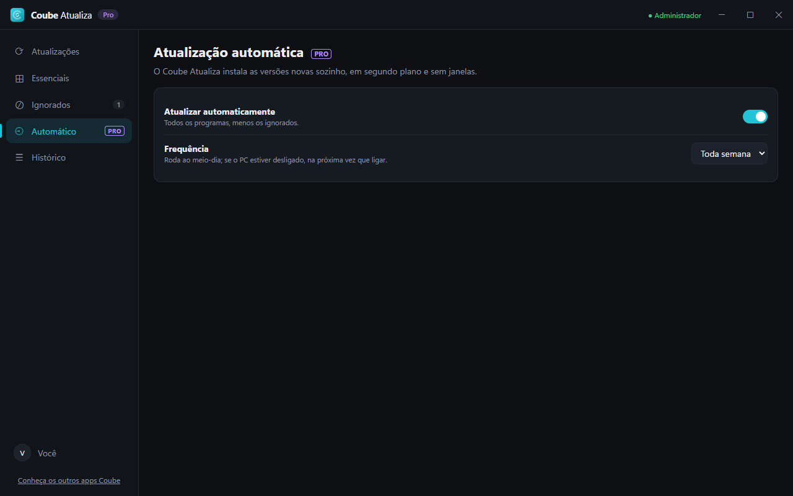

<h1 align="center">Coube Atualiza</h1>

<b>Programa desatualizado é porta aberta para vírus.</b> Atualizador de programas e instalador de programas essenciais para Windows. Parte da <b>Coube Solutions</b>.

  <a href="https://github.com/srlorenzos/coube-atualiza/releases/latest/download/Coube-Atualiza-Setup.exe"><b>⬇ Baixar grátis</b></a> ·
  <a href="https://github.com/srlorenzos/coube-atualiza/releases/latest/download/Coube-Atualiza-Portatil.exe">Versão portátil</a> ·
  <a href="https://coube-solutions.vercel.app/#precos">Planos</a> ·
  <a href="https://github.com/srlorenzos/coube-atualiza/issues/new/choose">Suporte</a>

> Esta é a página pública do Coube Atualiza: demonstração, novidades e suporte. O código-fonte é privado.

## O que ele faz

| | |
|---|---|
| ⟳ **Todas as atualizações numa tela** | Versão atual e nova de cada programa, direto da fonte oficial. |
| ⊞ **Programas essenciais** | Navegadores, comunicação, música e vídeo, utilitários, jogos e trabalho, instalados sem propaganda e sem clicar em "Avançar". |
| ⊘ **Ignorados** | Mantenha um programa na versão atual, sem ele voltar a aparecer. |
| ⚡ **Atualizar tudo e instalar em lote `PRO`** | Um clique para tudo. |
| ⏲ **Atualização automática `PRO`** | Todo dia, semana ou mês, em segundo plano e sem janelas. |

*As capturas usam o modo demonstração, com dados fictícios.*

## Planos

O Coube Atualiza é grátis para o dia a dia. Um **Coube Pro** (R$ 39,90/ano ou R$ 89,90 vitalício) libera os recursos `PRO` deste app e de todos os outros apps da Coube Solutions: Desinstalador, Turbo, Atualiza, Escudo e Drivers. Compre em **[coube-solutions.vercel.app](https://coube-solutions.vercel.app/#precos)**.

## Requisitos

Windows 10 ou 11, 64 bits. O app pede permissão de administrador, porque precisa dela para mexer no sistema.

Na primeira execução, o Windows pode mostrar *"O Windows protegeu o computador"*. Clique em **Mais informações › Executar assim mesmo**.

## Outros apps Coube

[Desinstalador](https://github.com/srlorenzos/coube-desinstalador) · [Turbo](https://github.com/srlorenzos/coube-turbo) · [Atualiza](https://github.com/srlorenzos/coube-atualiza) · [Escudo](https://github.com/srlorenzos/coube-escudo) · [Drivers](https://github.com/srlorenzos/coube-drivers)
